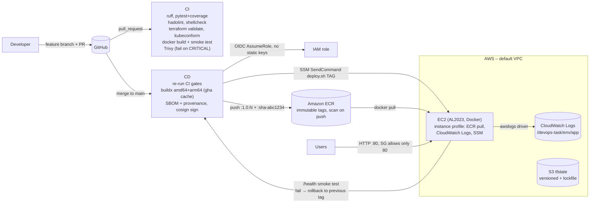
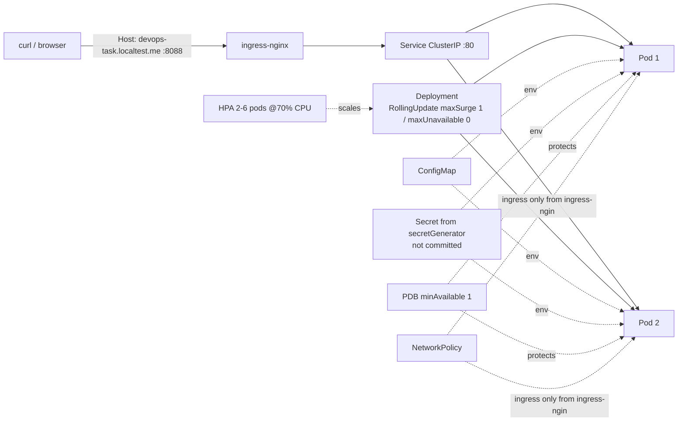
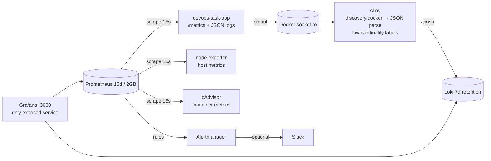
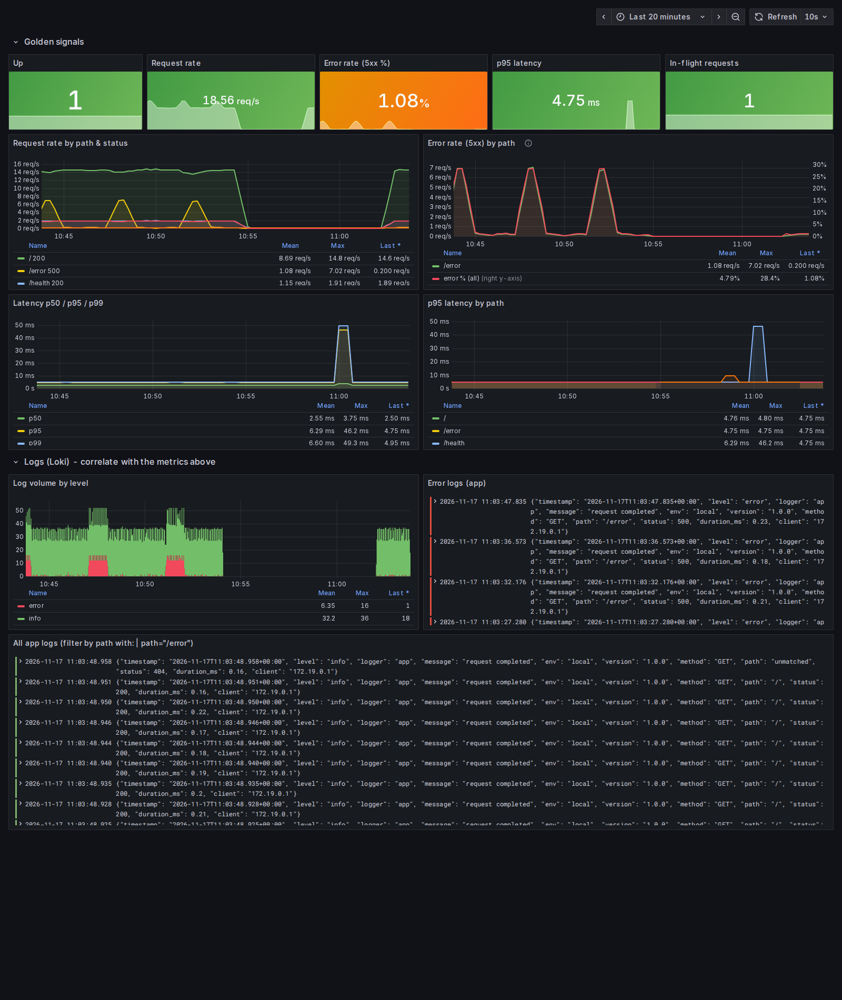
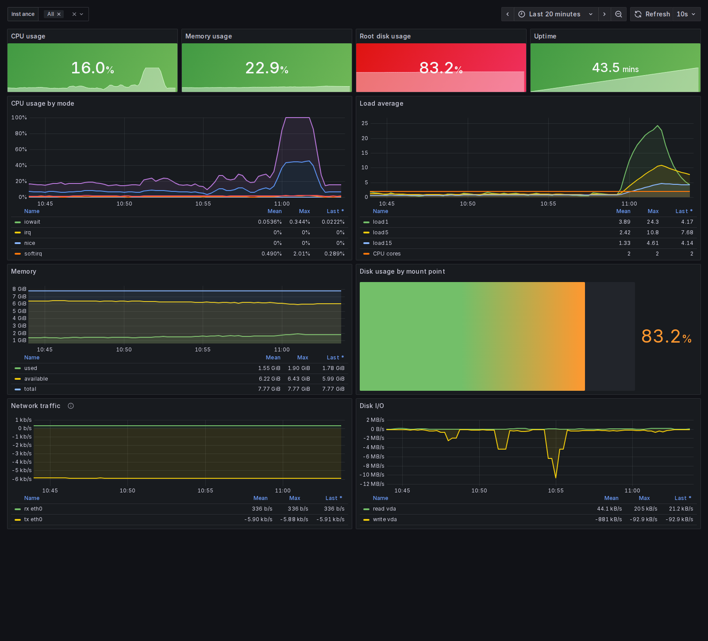
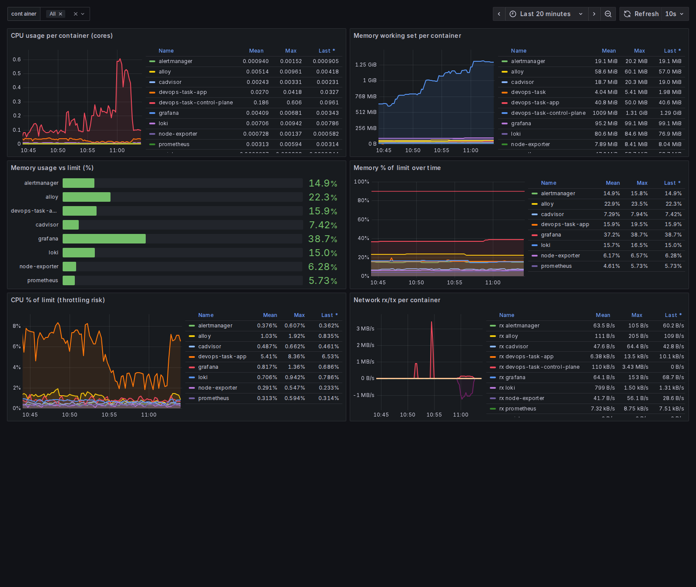

# DevOps Engineer Assessment – `devops-task`

A small FastAPI service, delivered end to end: container image, CI/CD, Terraform on AWS, a Kubernetes (kind) deployment, a full observability stack (Prometheus, Grafana, Loki, Alloy, Node Exporter, cAdvisor, Alertmanager) and a host health-check script.

| Area | Where |
|---|---|
| Application + unit tests | [`app/`](app), [`tests/`](tests) |
| Container | [`Dockerfile`](Dockerfile), [`.dockerignore`](.dockerignore), [`docker-compose.yml`](docker-compose.yml) |
| CI / CD | [`.github/workflows/ci.yml`](.github/workflows/ci.yml), [`.github/workflows/cd.yml`](.github/workflows/cd.yml), [`scripts/deploy.sh`](scripts/deploy.sh) |
| Infrastructure as Code | [`terraform/bootstrap`](terraform/bootstrap), [`terraform/environment`](terraform/environment) |
| Kubernetes | [`k8s/`](k8s) |
| Observability | [`docker-compose.monitoring.yml`](docker-compose.monitoring.yml), [`monitoring/`](monitoring) |
| Health script | [`scripts/system_health.sh`](scripts/system_health.sh), [`scripts/systemd/`](scripts/systemd), [`scripts/system-health.cron`](scripts/system-health.cron) |
| Evidence (outputs, screenshots) | [`docs/evidence/`](docs/evidence), [`docs/screenshots/`](docs/screenshots) |

---

## Prerequisites

| Tool | Version used | Needed for |
|---|---|---|
| Docker Engine + Compose v2 | 29.x / v2.40 | running the app and the monitoring stack |
| Python | 3.11+ | running tests locally |
| Terraform | >= 1.10 (tested with 1.13.4) | AWS infrastructure (S3-native state locking needs 1.10+) |
| AWS CLI v2 + an AWS account | – | Terraform apply, CD |
| kind / kubectl | 0.30.0 / 1.31 | Kubernetes part |
| hadolint, shellcheck, actionlint, tflint (optional) | latest | running the CI linters locally |

## Quick start (app + monitoring)

```bash
git clone https://github.com/nayan9744-web/devops-assessment.git && cd devops-assessment
cp .env.example .env            # set GRAFANA_ADMIN_PASSWORD; .env is git-ignored

# App only
docker compose up -d --build
curl -s localhost:8080/          # {"message":"Hello from DevOps Task!","status":"running","version":"1.0.0"}
curl -s localhost:8080/health
curl -s localhost:8080/metrics | head

# App + full observability stack
docker compose -f docker-compose.yml -f docker-compose.monitoring.yml up -d --build
docker compose -f docker-compose.yml -f docker-compose.monitoring.yml ps
```

Grafana: <http://localhost:3000> (log in with `GRAFANA_ADMIN_USER` / `GRAFANA_ADMIN_PASSWORD` from `.env`). Grafana is the only monitoring component that publishes a port, and it binds to `127.0.0.1` by default (`GRAFANA_BIND=0.0.0.0` changes that). Prometheus, Loki, Alertmanager, Alloy, cAdvisor and node-exporter sit on an internal Docker network only. If you need Prometheus for debugging, use `docker exec prometheus wget -qO- localhost:9090/api/v1/alerts`.

Optional Slack alerts (bonus): set `SLACK_WEBHOOK_URL` in `.env`. Alertmanager writes it to a file at start-up, so the URL never lands in a config file in git.

### Application endpoints

| Endpoint | Purpose |
|---|---|
| `GET /` | `{"message":"Hello from DevOps Task!","status":"running","version":"<APP_VERSION>"}` |
| `GET /health` | liveness/readiness, `{"status":"healthy"}` |
| `GET /metrics` | Prometheus: `http_requests_total{method,path,status}`, `http_request_errors_total`, `http_request_duration_seconds` histogram, `http_requests_in_progress`, `app_build_info` |
| `GET /error` | Demo only (`ENABLE_ERROR_ENDPOINT=true`). Returns 500 so you can create an error spike. Returns 404 otherwise. |

Configuration comes entirely from the environment: `PORT` (8080), `HOST`, `LOG_LEVEL`, `APP_ENV`, `APP_VERSION`, `GRACEFUL_TIMEOUT` (20 s), `ENABLE_ERROR_ENDPOINT`. Logs are single-line JSON on stdout. On SIGTERM, uvicorn stops accepting connections and drains in-flight requests for up to `GRACEFUL_TIMEOUT` seconds. The `path` metric label uses the route template, and unknown URLs are grouped under `unmatched`, so a scanner cannot blow up label cardinality.

## Running the tests and linters

```bash
python -m venv .venv && . .venv/bin/activate
pip install -r requirements.txt -r requirements-dev.txt
ruff check . && ruff format --check .
pytest                                   # 8 tests, coverage gate 80 % (currently ~97 %)

hadolint Dockerfile
shellcheck scripts/*.sh
actionlint
terraform -chdir=terraform/environment init -backend=false && terraform -chdir=terraform/environment validate
```

## Docker image

* Multi-stage build. Dependencies are installed into a venv in `python:3.11-slim-bookworm`, then copied into `gcr.io/distroless/python3-debian12:nonroot`. Both base images are pinned by digest, and Dependabot updates them.
* Runs as UID 65532 (non-root). There is no shell or package manager in the final image.
* A `HEALTHCHECK` uses the Python interpreter, because distroless has no curl. OCI labels (`org.opencontainers.image.*`) are set from build args.
* `.dockerignore` is an allowlist: only `app/`, `requirements.txt` and `VERSION` go into the build context.
* **Image size: ~96 MB uncompressed (`docker images`), ~23 MB compressed** (as pulled into the kind node, shown by `crictl images`). The distroless Python base alone is ~80 MB, so the app and its dependencies add ~16 MB. I chose distroless over alpine to keep glibc wheels (no musl rebuilds) and to remove the shell from the attack surface.
* `docker-compose.yml`: port 8080, healthcheck, `restart: unless-stopped`, CPU/memory limits (0.5 CPU / 256 MB), `read_only: true`, `cap_drop: [ALL]`, `no-new-privileges`.

## Architecture

### CI/CD and AWS



### Kubernetes (kind)



### Observability



## Design decisions

| Decision | Why |
|---|---|
| **FastAPI + uvicorn** | Small, async, easy to instrument with `prometheus-client`. Native graceful shutdown (`timeout_graceful_shutdown`). |
| **Distroless over alpine** | No shell or package manager means fewer CVEs and a smaller attack surface. glibc keeps prebuilt wheels working. The trade-off is that you can't `docker exec sh`; use `kubectl debug` or an ephemeral debug container instead. |
| **Single EC2 + Docker instead of ECS/EKS for the AWS part** | Matches the assessment scope and keeps cost at roughly $15–30/month. ECS Fargate would be the next step. EKS only makes sense with many services (see "EKS production notes"). |
| **SSM Run Command instead of SSH** | No port 22 open, no SSH keys to rotate in GitHub, and every deploy command is audited in CloudTrail and SSM history. |
| **GitHub OIDC → IAM role** | No long-lived AWS keys in GitHub. The role trust is restricted to `repo:nayan9744-web/devops-assessment` on `main` and the `staging`/`production` environments. |
| **Tagging: `MAJOR.MINOR.<run_number>` + `sha-<7>`, no `latest`** | The ECR repo uses **immutable tags**, so a tag always means the same bytes. The SHA tag links an image to its commit, and the semver tag is easy for people to read and roll back to. `latest` is ambiguous and is never deployed. |
| **S3 remote state with `use_lockfile = true`** | Terraform 1.10+ supports S3-native locking, so no DynamoDB table is needed. The bucket is versioned, encrypted, private and TLS-only. The bucket/ECR/OIDC role live in a separate `bootstrap` stack, which avoids a chicken-and-egg problem. |
| **One environment module + `envs/*.tfvars` / `*.s3.tfbackend`** | Staging and production use the same code with different sizes and retention, and separate state files. That's simpler than workspaces and harder to confuse. |
| **Alloy for logs** | Grafana's current agent (Promtail is deprecated). It discovers containers through the Docker socket, so it needs no per-container config. |
| **Low-cardinality Loki labels** | Labels are `service`, `container`, `project`, `environment`, `level`, all bounded sets. High-cardinality fields (`path`, `status`, `method`) are stored as **structured metadata**, so they stay filterable (`{service="app"} | path="/error"`) without creating a stream per value. |

## Deployment and rollback strategy

**EC2 (CD pipeline).** `scripts/deploy.sh` is installed on the instance by user data. CD calls it through SSM with the new tag:

1. `docker pull` the new image from ECR. If the pull fails, the deploy aborts and the running container is untouched.
2. Stop the current container and start the new one (awslogs driver → CloudWatch).
3. Smoke-test `http://localhost/health` with retries, and check that `/` reports the expected version.
4. **On failure:** remove the new container, start the previous tag (`/opt/devops-task/previous_tag`) again, verify it, and exit 1. The workflow fails and shows the deploy output.
5. On success, write `current_tag`/`previous_tag`. Then the workflow runs an **external** smoke test against the public DNS. If that fails, a second SSM command rolls back to `previous_tag`.

The rollback was tested locally. `1.0.0 → 1.0.1` succeeded, then a deliberately broken `1.0.2-broken` was rolled back automatically to `1.0.1` ([evidence](docs/evidence/deploy-rollback-local.txt)).

Manual rollback: run the CD workflow again for an older commit, or `aws ssm send-command ... "/opt/devops-task/deploy.sh 1.0.41"`. Every tag in ECR is immutable, so redeploying an old tag gives exactly the same image.

Known limitation: a single host means a few seconds of downtime during the container swap. With more time I would run blue/green on two ports behind a local reverse proxy, or move to an ALB with two instances or ECS rolling deployments.

**Kubernetes.** `RollingUpdate` with `maxSurge: 1, maxUnavailable: 0`, a startup/readiness probe gate, a `preStop` sleep so endpoints are removed before SIGTERM, and a PDB. Rollback is `kubectl rollout undo`. A demo is below.

## Infrastructure as Code (Terraform)

```
terraform/
├── bootstrap/        # one-time: S3 state bucket, ECR repo (immutable, scan-on-push, lifecycle),
│                     # GitHub OIDC provider + least-privilege deploy role
└── environment/      # per environment: EC2 (default VPC, IMDSv2, encrypted gp3), SG (HTTP only),
    │                 # instance profile (ECR pull on 1 repo, logs on 1 group, SSM core),
    │                 # CloudWatch log group with retention, user data that installs Docker
    └── envs/{staging,production}.{tfvars,s3.tfbackend}
```

| | staging | production |
|---|---|---|
| Instance | t3.micro | t3.small |
| Root volume | 20 GB gp3 | 30 GB gp3 |
| Log retention | 7 days | 30 days |
| Detailed monitoring | off | on |

```bash
export AWS_PROFILE=...                      # or any credentials with admin rights for the first run
# 1) bootstrap (local state, run once)
cd terraform/bootstrap
terraform init && terraform apply           # outputs: state_bucket, ecr_repository_url, github_actions_role_arn

# 2) put the bucket name into environment/envs/staging.s3.tfbackend (and production)
cd ../environment
terraform init -backend-config=envs/staging.s3.tfbackend
terraform plan  -var-file=envs/staging.tfvars -out=staging.tfplan
terraform apply staging.tfplan              # outputs: instance_id, public_ip, app_url, log_group

# production uses a separate state:  terraform init -reconfigure -backend-config=envs/production.s3.tfbackend
# 3) clean up afterwards
terraform destroy -var-file=envs/staging.tfvars
cd ../bootstrap && terraform destroy        # empty the ECR repo / state bucket first if needed
```

Security group: inbound only TCP 80 from `allowed_http_cidrs`; outbound only 443 (ECR, SSM, CloudWatch, Docker install) and 80 (package mirrors). There's no SSH because access goes through SSM Session Manager.

> **Evidence note.** I couldn't run `terraform apply` against a real AWS account in my build environment. I verified the code with `terraform fmt -check`, `terraform validate` and `tflint` for both stacks. Screenshots of `plan`, `apply` and `destroy` from a real account belong in `docs/evidence/terraform-*.png`. See "What the reviewer should know" below.

## CI/CD (GitHub Actions)

**CI (`ci.yml`, on every PR and reused by CD):** ruff lint + format check → pytest with coverage (fails under 80 %, coverage summary posted to the PR) → hadolint → shellcheck → terraform fmt/validate → kubeconform for `k8s/` → buildx build + container smoke test → **Trivy image scan, fails on CRITICAL** (SARIF uploaded to code scanning).

**CD (`cd.yml`, on push to `main` or manual dispatch with environment choice):** re-runs CI → computes version `$(cat VERSION | cut -d. -f1,2).${run_number}` → OIDC login → ECR login → multi-arch build (`linux/amd64,linux/arm64`, GitHub Actions cache) with SBOM + provenance attestations → push `:<semver>` and `:sha-<7>` → cosign keyless signing (bonus) → deploy through SSM with smoke test and automatic rollback.

### Required GitHub configuration

| Name | Type | Value / source |
|---|---|---|
| `AWS_ROLE_ARN` | Repository **variable** | `terraform -chdir=terraform/bootstrap output -raw github_actions_role_arn` |
| `AWS_REGION` | Repository variable | `ap-southeast-1` (or your region) |
| `ECR_REPOSITORY` | Repository variable | `devops-task` |
| `staging`, `production` | **Environments** | Add required reviewers on `production` for a manual approval gate |
| *(no secrets)* | – | OIDC removes the need for `AWS_ACCESS_KEY_ID`/`SECRET`. `GITHUB_TOKEN` is used for the PR comment and SARIF upload. |

Local or runtime secrets (never committed): `GRAFANA_ADMIN_USER`, `GRAFANA_ADMIN_PASSWORD`, `SLACK_WEBHOOK_URL` in `.env`; `HEALTH_WEBHOOK_URL` for the health script; `k8s/secret.env` for the Kubernetes Secret.

## Kubernetes (kind)

Manifests in `k8s/` are applied with Kustomize: Namespace (Pod Security Standard `restricted`), ServiceAccount (no token automount), ConfigMap, Secret (generated from the git-ignored `k8s/secret.env`), Deployment (2 replicas, rolling update, startup/readiness/liveness probes, requests 50m/64Mi and limits 250m/128Mi, `runAsNonRoot` UID 65532, `readOnlyRootFilesystem`, all capabilities dropped, seccomp `RuntimeDefault`, `emptyDir` for `/tmp`), Service, Ingress (nginx), HPA (2–6 replicas at 70 % CPU), PodDisruptionBudget and NetworkPolicy.

```bash
kind create cluster --name devops-task --config k8s/kind-config.yaml      # maps host :8088 → ingress :80
kubectl apply -f https://raw.githubusercontent.com/kubernetes/ingress-nginx/main/deploy/static/provider/kind/deploy.yaml
kubectl apply -f https://github.com/kubernetes-sigs/metrics-server/releases/latest/download/components.yaml
kubectl -n kube-system patch deploy metrics-server --type=json \
  -p='[{"op":"add","path":"/spec/template/spec/containers/0/args/-","value":"--kubelet-insecure-tls"}]'   # kind only

docker build -t devops-task:1.0.0 --build-arg APP_VERSION=1.0.0 .
docker build -t devops-task:1.0.1 --build-arg APP_VERSION=1.0.1 .
kind load docker-image devops-task:1.0.0 devops-task:1.0.1 --name devops-task

cp k8s/secret.env.example k8s/secret.env                                  # git-ignored
kubectl apply -k k8s/
kubectl -n devops-task rollout status deploy/devops-task
curl -H 'Host: devops-task.localtest.me' http://localhost:8088/
```

### Rolling update and rollback demo

The full output is in [`docs/evidence/k8s-rolling-update-rollback.txt`](docs/evidence/k8s-rolling-update-rollback.txt). A traffic generator hit the Ingress every 50 ms during both rollouts: **916 of 916 requests returned HTTP 200**, so there was zero downtime.

```text
$ kubectl -n devops-task set image deployment/devops-task app=devops-task:1.0.1
deployment.apps/devops-task image updated
$ kubectl -n devops-task rollout status deployment/devops-task --timeout=120s
Waiting for deployment "devops-task" rollout to finish: 1 out of 2 new replicas have been updated...
Waiting for deployment "devops-task" rollout to finish: 1 old replicas are pending termination...
deployment "devops-task" successfully rolled out
$ curl -s -H 'Host: devops-task.localtest.me' http://localhost:8088/
{"message":"Hello from DevOps Task!","status":"running","version":"1.0.1"}

$ kubectl -n devops-task rollout undo deployment/devops-task
deployment.apps/devops-task rolled back
$ kubectl -n devops-task rollout status deployment/devops-task --timeout=120s
deployment "devops-task" successfully rolled out
$ kubectl -n devops-task get rs -o wide
NAME                     DESIRED   CURRENT   READY   IMAGES
devops-task-747d58d898   0         0         0       devops-task:1.0.1
devops-task-7cb9dd6459   2         2         2       devops-task:1.0.0
$ curl -s -H 'Host: devops-task.localtest.me' http://localhost:8088/
{"message":"Hello from DevOps Task!","status":"running","version":"1.0.0"}

traffic during both rollouts: total 916, HTTP 200: 916
```

HPA under load (scaled from 2 to 6 replicas): [`docs/evidence/k8s-hpa.txt`](docs/evidence/k8s-hpa.txt).

> **Note on my build environment:** the sandbox kernel had no kube-proxy support, so there I ran ingress-nginx with `hostNetwork` and pointed in-cluster clients at the API server IP. On a normal machine, the standard kind manifests above work unchanged.

### Changes needed for production on EKS

* **Ingress:** AWS Load Balancer Controller with `ingressClassName: alb`, an ACM certificate, HTTPS only, and WAF. Use `target-type: ip` so the ALB targets pods directly.
* **Images:** ECR with immutable tags and digests in manifests. Deploy through GitOps (Argo CD/Flux) or Helm instead of `kubectl apply`. Admission policy (Kyverno/Gatekeeper) to require signed images (cosign) and non-root containers.
* **Secrets:** External Secrets Operator or the Secrets Store CSI driver with AWS Secrets Manager. No Kubernetes Secrets in git, and KMS envelope encryption for etcd.
* **Identity:** IRSA / EKS Pod Identity per ServiceAccount instead of node-wide IAM.
* **Scaling and resilience:** Karpenter or Cluster Autoscaler for nodes. HPA on CPU plus request rate (custom metrics), `topologySpreadConstraints` across AZs, PDBs, multiple node groups across 3 AZs.
* **Observability:** kube-prometheus-stack or Amazon Managed Prometheus/Grafana, Loki/CloudWatch for logs, ServiceMonitors instead of static scrape configs.
* **Networking:** VPC CNI with network policies enabled, private subnets for nodes, private API endpoint.

## Observability

Everything is configuration as code. Prometheus, Loki, Alertmanager and Alloy configs live in `monitoring/`. Grafana **datasources and dashboards are provisioned** from `monitoring/grafana/provisioning` and `monitoring/grafana/dashboards`, so nothing is clicked together by hand. All images are pinned to specific versions.

| Component | Image | Retention / notes |
|---|---|---|
| Prometheus | `prom/prometheus:v3.5.0` | `--storage.tsdb.retention.time=15d`, `--storage.tsdb.retention.size=2GB` |
| Loki | `grafana/loki:3.5.3` | `retention_period: 168h` (7 days), applied by the compactor, TSDB v13 schema, structured metadata |
| Alloy | `grafana/alloy:v1.10.1` | Docker discovery and JSON parsing |
| Grafana | `grafana/grafana:12.1.1` | Admin credentials **only from env** (`${GRAFANA_ADMIN_PASSWORD:?}`, so compose refuses to start without it), anonymous access and sign-up disabled |
| node-exporter | `prom/node-exporter:v1.9.1` | host metrics |
| cAdvisor | `ghcr.io/google/cadvisor:0.54.1` | container metrics (0.52.x can't read Docker 29's containerd image store) |
| Alertmanager | `prom/alertmanager:v0.28.1` | Slack receiver (bonus), grouping and inhibition rules |

### Log pipeline (Alloy)

`discovery.docker` → `discovery.relabel` keeps only containers of this compose project and maps `com.docker.compose.service` → `service`, plus `container` and `project` → `loki.source.docker` → `loki.process`:

* For `service="app"`, the `stage.json` parser extracts `level`, `path`, `status`, `method` and `timestamp`. `level` becomes a label. `path`, `status` and `method` are **structured metadata**, not labels. The log timestamp is taken from the JSON.
* Other containers: the level is pulled out with a regex and lowercased, so `level` has a small, consistent set of values.
* A static `environment` label is added.

The result is about 10 streams per environment, which keeps Loki's index small, and you can still filter by any field.

### Dashboards

| Dashboard | What it shows | Screenshot |
|---|---|---|
| **Application (RED)** | Up, request rate by path/status, 5xx error rate (req/s and %), latency p50/p95/p99 from the histogram, p95 per path, in-flight requests, **Loki log volume by level, error logs and full app logs next to the metrics** |  |
| **Host** | CPU by mode, memory, load vs CPU cores, disk usage per mount point, disk I/O, network |  |
| **Containers** | CPU per container, CPU % of limit (throttling risk), memory working set, **memory usage vs limit (%)**, network rx/tx |  |

### Alerts (`monitoring/prometheus/alerts.yml`)

| Alert | Condition | `for` | Why this threshold |
|---|---|---|---|
| `AppInstanceDown` (critical) | `up{job="app"} == 0` | 1m | The app is the product. One minute tolerates a single failed scrape or a restart during a deploy (the smoke test takes ~10 s), but pages fast on a real outage. |
| `AppHighErrorRate` (critical) | 5xx / all requests > **5 %** over 5m, **and** > 0.1 req/s of traffic | 5m | 5 % is well above normal background errors but low enough to catch a bad release. The traffic guard stops "1 error out of 2 requests = 50 %" false alarms at night. |
| `AppHighLatencyP95` (warning) | p95 from `histogram_quantile` > **500 ms** | 10m | Normal p95 is ~5 ms (see the dashboard). 500 ms is a user-visible slowdown. 10 minutes avoids paging on short GC or cold-start bursts. |
| `HostDiskUsageHigh` (warning) | any real filesystem > **80 %** | 10m | Leaves roughly 20 % headroom (several days at normal log and image growth) to clean up or resize before Docker or Loki fail. Disk fills slowly, so 10 minutes removes noise from temporary files. |
| `HostHighCpuUsage` (warning) | CPU > **90 %** | 10m | Short CPU spikes (image pulls, builds) are normal. Sustained saturation for 10 minutes means latency will suffer. On burstable t3 instances it also burns CPU credits. |
| `HostMemoryUsageHigh` (critical) | memory (based on MemAvailable) > **90 %** | 5m | Above 90 % the OOM killer is close. 5 minutes is shorter than the CPU alert because running out of memory kills processes. |
| `ContainerMemoryNearLimit` (warning) | working set > **90 % of the container limit** | 5m | The container will be OOM-killed at 100 %. This gives time to raise the limit or find a leak. |
| `MonitoringTargetDown` (warning) | an exporter or monitoring component is down | 5m | Shows when you're flying blind (missing metrics are not the same as healthy). |

Current state in my environment ([`docs/evidence/prometheus-alert-rules.txt`](docs/evidence/prometheus-alert-rules.txt)): all 8 rules are loaded, all scrape targets are `up`, and `HostDiskUsageHigh` is **really firing** because the sandbox disk sits at ~84 %. That's a nice real-world check that the rule works.

### Why cAdvisor and node-exporter need these mounts and privileges

| Service | Mount / privilege | Why |
|---|---|---|
| node-exporter | `/:/host:ro,rslave` + `--path.rootfs=/host` | Reads the host's `/proc`, `/sys` and mounted filesystems (read-only) so CPU, memory, load and disk refer to the **host**, not the container. `rslave` makes mounts added later (new volumes) visible. |
| node-exporter | `pid: host` | Sees host processes and namespaces for accurate process and load metrics. |
| cAdvisor | `/:/rootfs:ro`, `/sys:/sys:ro`, `/var/lib/docker:ro`, `/dev/disk:ro` | cgroup stats come from `/sys/fs/cgroup`, container metadata and filesystem usage from the Docker data dir, and disk device names from `/dev/disk`. All read-only. |
| cAdvisor | `/var/run:/var/run:ro` | Docker/containerd socket, used to map cgroups to container names. |
| cAdvisor | `privileged: true`, `/dev/kmsg` | Reading every container's cgroup files and OOM events from the kernel log needs privileges. This is the documented cAdvisor requirement. The risk is limited because cAdvisor is on the internal `monitoring` network only, publishes no port, and many metric groups are disabled. |
| Alloy | `/var/run/docker.sock:ro` | Container discovery and log reading. (A read-only mount of the socket still allows API calls, so Alloy is also kept off any public network.) |

### Error spike walkthrough

1. Generate an error spike (the demo endpoint is enabled in `.env`):
   ```bash
   for i in $(seq 1 300); do curl -s -o /dev/null localhost:8080/error; curl -s -o /dev/null localhost:8080/; done
   ```
2. In **Application (RED)**, the **Error rate (5xx) by path** panel jumps (in the screenshot, up to ~28 % on the right axis) and the series is `/error`, so the panel already tells you *which route* is failing.
3. In the same dashboard, the **Log volume by level** panel shows red `error` bars at the same timestamps. The **Error logs (app)** panel lists the matching JSON lines: `"path": "/error", "status": 500`.
4. To drill down, open Explore → Loki and run `{service="app", level="error"} | path="/error"` (structured metadata filter). Each line has `method`, `status`, `duration_ms` and the app `version`, so you can tell whether a new release caused it.
5. If the error ratio stays above 5 % for 5 minutes, `AppHighErrorRate` fires and Alertmanager sends it to Slack (if configured). The p95 panel shows whether latency was affected too.
6. Fix or roll back (`deploy.sh <previous_tag>` / `kubectl rollout undo`) and watch the error rate drop back to 0 in the same panel.

## System health script

`scripts/system_health.sh` (bash, `set -euo pipefail`, shellcheck-clean) reports CPU (sampled from `/proc/stat`), memory (MemAvailable based), **all** real filesystems, load average and the top 5 processes by memory. It appends to `health_log.txt` and rotates the log (`--max-size`, `--keep`).

```bash
./scripts/system_health.sh                       # human readable, appends to ./health_log.txt
./scripts/system_health.sh --json                # one JSON object (also logged)
./scripts/system_health.sh --disk 80 --cpu 90 --mem 85
./scripts/system_health.sh --help
```

* Prints `[WARNING]` when a value is at or above the threshold, and `[CRITICAL]` at threshold + `--crit-margin` (default 10).
* Exit codes: **0** healthy, **1** warning, **2** critical, **3** usage error.
* Bonus: if `HEALTH_WEBHOOK_URL` is set, warnings and criticals are POSTed to a Slack/Discord webhook.
* Sample output (text, JSON, critical): [`docs/evidence/system-health-sample.txt`](docs/evidence/system-health-sample.txt).

Scheduling every 5 minutes (choose one):

```bash
sudo install -m 0755 scripts/system_health.sh /usr/local/bin/system_health.sh
# systemd (preferred: journald logs, sandboxing, Persistent=true)
sudo cp scripts/systemd/system-health.{service,timer} /etc/systemd/system/
sudo systemctl daemon-reload && sudo systemctl enable --now system-health.timer
systemctl list-timers system-health.timer
# or cron
sudo cp scripts/system-health.cron /etc/cron.d/system-health
```

## Security considerations

* **No static cloud credentials:** GitHub → AWS uses OIDC with a role scoped to this repo, its branch and environments, ECR push on one repository, and `ssm:SendCommand` only on instances tagged `Project=devops-task` with the `AWS-RunShellScript` document.
* **Least-privilege instance profile:** ECR pull on one repository, `logs:CreateLogStream/PutLogEvents` on one log group, `AmazonSSMManagedInstanceCore`. Nothing else.
* **Network:** SG allows only HTTP in. No SSH (SSM Session Manager instead). IMDSv2 required (hop limit 1). Encrypted EBS.
* **Supply chain:** base images pinned by digest, Dependabot for pip, Docker, Actions and Terraform, Trivy fails the build on CRITICAL CVEs, SBOM + provenance attestations, cosign keyless signatures, immutable ECR tags with scan on push.
* **Runtime:** non-root UID 65532, distroless (no shell), read-only root FS, all capabilities dropped, `no-new-privileges`, resource limits. Kubernetes adds PSS `restricted`, seccomp `RuntimeDefault`, no SA token automount and a NetworkPolicy.
* **Secrets:** nothing secret in git (`.env`, `*.env`, `k8s/secret.env` are git-ignored; only `.example` files are committed). Grafana refuses to start without credentials. The Slack URL is passed through env.
* **Monitoring exposure:** only Grafana publishes a port, and only on `127.0.0.1` by default. Prometheus, Loki and the exporters are on an internal network.
* **Terraform state:** S3 bucket is versioned, SSE encrypted, public access blocked, TLS-only bucket policy, with native locking.

## Monthly AWS cost estimate (ap-southeast-1, on-demand, approximate)

| Item | Staging | Production |
|---|---|---|
| EC2 (t3.micro ~$0.0132/h, t3.small ~$0.0264/h × 730 h) | ~$9.6 | ~$19.3 |
| EBS gp3 (~$0.096/GB-month: 20 GB / 30 GB) | ~$1.9 | ~$2.9 |
| Public IPv4 address (~$0.005/h) | ~$3.7 | ~$3.7 |
| CloudWatch Logs (~1 GB ingest at ~$0.70/GB plus storage) | ~$0.8 | ~$1.5 |
| EC2 detailed monitoring | – | ~$2.1 |
| ECR storage (~1 GB, lifecycle keeps the last N images) | ~$0.1 | shared |
| S3 state + requests, SSM, data transfer (low traffic) | < $1 | < $1 |
| **Total** | **≈ $16/month** | **≈ $30/month** |

Optional: an ALB for HTTPS adds about $20/month. A 1-year Savings Plan or a t4g (Graviton) instance cuts EC2 cost by roughly 20–40 %, and the image is already multi-arch. Prices are approximate list prices at the time of writing. Check them in the [AWS Pricing Calculator](https://calculator.aws/) before you rely on them.

## What I would improve with more time

* Zero-downtime deploys on EC2: blue/green behind Caddy/nginx on the host, or an ALB with two instances in an ASG and instance refresh. Alternatively ECS Fargate.
* HTTPS everywhere (ALB + ACM or Caddy with Let's Encrypt) and restricting the SG to the load balancer.
* Run the monitoring stack on the EC2 host as well, shipping to Amazon Managed Prometheus/Grafana, plus a CloudWatch alarm on `StatusCheckFailed`.
* SLOs with multi-window burn-rate alerts instead of static thresholds. Alert runbook links.
* Tracing with OpenTelemetry → Tempo, plus exemplars that link latency spikes to traces.
* Helm chart (or a Kustomize overlay per environment) plus Argo CD for Kubernetes. Integration tests on kind in CI.
* Terraform: a module registry layout, `checkov`/`tfsec` in CI, and `terraform plan` posted as a PR comment through OIDC with a read-only role.
* Ansible playbook for hosts that aren't built with user data.

## What the reviewer should know (evidence and limitations)

Everything below was built **and run** in my environment: unit tests, all linters, Docker build and compose, the full monitoring stack with real dashboards and firing alerts, the health script, the deploy script with an automatic rollback, and kind with a zero-downtime rolling update, rollback and HPA. Outputs are in `docs/evidence/`.

Two things need a real cloud account and could not be run from my build environment:

1. **Terraform plan/apply/destroy on AWS.** Run the commands in the Terraform section. Screenshots go in `docs/evidence/terraform-plan.png`, `terraform-apply.png`, `terraform-destroy.png`.
2. **GitHub Actions runs.** CI runs on the first PR, and CD runs after the repo variables and environments above are set. Screenshots go in `docs/evidence/ci-run.png`, `cd-run.png`.

## AI usage

I used an AI assistant (Perplexity Computer) as a pair programmer. It helped scaffold files, draft documentation and generate the Grafana dashboard JSON. Every file was reviewed, and everything was actually executed and tested: linters, unit tests, Docker builds, the monitoring stack, the kind cluster, rollout and rollback, and the health script. The design decisions, thresholds and trade-offs in this README are mine, and I can explain any line of the code.
